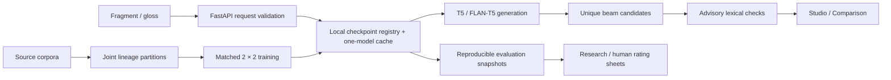

# GlossWeaver

GlossWeaver reconstructs fluent English from incomplete or telegraphic text.
Sign-language gloss output is an application; ASL has its own complete grammar.
The system is text-only: it does not recognize signing from video.

```text
ME GO STORE YESTERDAY → I went to the store yesterday.
```

This is an illustrative target, not a guarantee of the current installed model.
This checkout preserves historical evaluation results whose original E1–E4
weight files are missing. The new `study-augmentation` FLAN-T5-small checkpoint was trained on the
repaired datasets. `reconstruction-flan` continues it with a separate synthetic
time/quantity adaptation pass. The default `balanced-flan` adds broader data
and untimed examples in a further 600-step continuation. Completed study checkpoints are selected before pretrained models.
The UI also exposes cached original T5-small and FLAN-T5-small weights separately
for comparison when those cache files are present. These base models can still copy input
or change its meaning; they are not the models behind the historical E1–E4 scores.
The copy baseline only normalizes text and does not restore missing grammar.
Testing the historical E1–E4 models still requires restoring their original weights.

For custom inputs, choose **FLAN-T5-small · balanced** (the default).
**FLAN-T5-small · reconstruction** remains selectable for comparison.
**Study · Augmentation · fine-tuned** is the preceding matched-study checkpoint.
The deployment adaptation is a separate recipe, not a matched research ablation.
The pretrained entries are comparison baselines. See
`results/RECONSTRUCTION_TRAINING.md` for measured scope and remaining errors.

The pretrained FLAN prompt asks for a complete English sentence and lowercases
all-capital glosses before generation. The fine-tuned models retain their shared
training prompt. Cached pretrained models are discovered through local Hugging
Face revision pointers; the API never downloads weights during a request.

## Run the custom-input workbench

```bash
python3 -m venv .venv
source .venv/bin/activate
pip install -e '.[api,dev]'
cd frontend
npm ci
npm run build
cd ..
uvicorn app.api:app --host 127.0.0.1 --port 8000
```

Open http://127.0.0.1:8000. Write your own text, choose an available model, and
select **Reconstruct sentence**, or use Cmd/Ctrl + Enter. Results show the model
and timing. The session log supports review and JSON export; it is held in memory
and clears on page reload. Model status can be refreshed after training. The **Datasets** tab shows local
folders and split sizes read from preprocessing manifests.

During frontend development, run `npm run dev` in `frontend`; Vite proxies API
requests to the backend at port 8000. `npm run preview` alone does not proxy the
API: use the backend-served build for full integration testing.

## Datasets already prepared locally

- `datasets/raw/aslg_pc12/`: pinned rule-generated ASLG-PC12 corpus.
- `datasets/processed/aslg_grouped/`: repaired, source-grouped ASLG splits.
- `datasets/raw/2m_flores_asl/`: official human-annotated 2M-Flores text export,
  with revision, license and checksums; video excluded.
- `datasets/processed/2m_flores_asl/`: normalized external dev/devtest pairs.
- `datasets/processed/reconstruction_grouped/`: separately rebuilt synthetic
  reconstruction splits with precomputed deterministic weak grammar labels.

- `datasets/processed/balanced_adaptation/`: deployment mixture and held-out
  untimed diagnostics; rebuild with `scripts/prepare_balanced_adaptation.py`.

Reproduce acquisition and preprocessing:

```bash
python scripts/download_data.py aslg-pc12
python scripts/prepare_data.py
python scripts/download_external_data.py
python scripts/prepare_research_data.py
```

Use `python scripts/download_external_data.py --offline` to preprocess a local
2M-Flores export. The ASLG loader checks the pinned source schema and size.
The external devtest set is reserved for final evaluation; it is not a training
split. See `datasets/README.md` for counts and preprocessing policy.

Historical splits/results are retained separately. Repaired splits do not
retroactively validate old scores. Rebuilding the historical ASLG folder changes
its assignments under the new grouped splitter; use versioned research folders
for new experiments and retain the old artifacts when reproducing historical work.

## New research experiments

The four matched presets use FLAN-T5-small, common data selection and validation,
independent initialization, and 1,000 optimizer steps. Each uses seeded uniform
sampling with replacement and validates every 250 updates, so corpus size does
not change checkpoint-selection opportunities:

| Preset | Synthetic training data | Auxiliary grammar objective |
|---|---|---|
| `study-baseline` | No | No |
| `study-augmentation` | Yes | No |
| `study-grammar` | No | Yes |
| `study-full` | Yes | Yes |

```bash
python -m glossweaver.training.train --preset study-full --device mps --seed 42
```

Use `--device cuda` on NVIDIA, `--device cpu` without an accelerator. Repeat with
additional training seeds; dataset selection stays fixed at dataset seed 42.
Each run writes to a new directory under `checkpoints/<preset>/`. `latest.json`
points to the completed run, and the matching study model appears in the UI after
refresh. Historical E1–E4 recipes remain available but now reject overlapping
training/validation sources; new grouped data should be used for new claims.

Run manifests store complete config, data hashes, selected IDs, library versions
and initialization lineage. Optimizer/scheduler state is saved for future resume
support; automatic exact resume is not implemented. Continued training creates a
new run and resets the optimizer. Labels default to deterministic `lexical-v1`;
explicit spaCy use requires `GLOSSWEAVER_GRAMMAR_PARSER=spacy-en_core_web_sm` and an
installed parser. Grouped preprocessing should use the default policy.

Evaluate a trained study model on external development data:

```bash
python -m glossweaver.evaluation.evaluate \
  --model study-full \
  --dataset-file datasets/processed/2m_flores_asl/dev.jsonl \
  --dataset-name 2m_flores_asl --split dev \
  --device mps --output results/predictions/study_full_flores_dev.csv
```

Reserve devtest for the final frozen model. Evaluation writes immutable snapshots
under `results/evaluations/`, with checkpoint/data/sample hashes and scorer
configuration. Limited evaluation samples cover corpus origins rather than file
prefixes. Avoid running evaluation writers concurrently; the consolidated CSV is
a convenience index, and snapshots are the authoritative artifacts.

## Verification

```bash
pytest
python scripts/run_smoke_test.py
cd frontend
npm run lint
npm run build
```

## Limitations and evidence

Fluency does not imply correct meaning. Verify negation, names, quantities, time
and semantic roles. Inputs without context may allow several correct outputs.
Grammar probabilities are auxiliary feature estimates, not translation confidence.

`results/REPORT.md` contains historical results from 500-example domain slices
and a nine-example development challenge. The challenge should be used for
regression checks, not as proof of real-world ASL translation. New source-isolated
splits, matched comparisons, multiple seeds and human evaluation are required
before writing new research claims.

See `plan.md` for implementation status and `PROJECT_AUDIT.md` for the original
review. `GLOSSWEAVER_ROOT` can point the installed package to the project artifact
root. The backend binds locally by default; configured CORS origins can be set
with `GLOSSWEAVER_CORS_ORIGINS`.

## GlossWeaver 2.0

The laboratory now includes Overview, Reconstruction Studio, Model Comparison, Research & Evaluation, Model Library, Datasets, and Settings/About. It uses a graphite and cyan design, keyboard-accessible native controls, responsive navigation, semantic notices, actual checkpoint identities, beam alternatives, surface edit alignment, and a session export. The Research module is loaded separately and displays real saved results, metric filters/sorting, provenance, and example-level analysis.



### Install and run

From the repository root:

```bash
python3 -m venv .venv
source .venv/bin/activate
python -m pip install -e '.[api,dev]'
npm --prefix frontend ci
uvicorn app.api:app --host 127.0.0.1 --port 8000
```

In another terminal, from the repository root:

```bash
npm --prefix frontend run dev
```

Open http://localhost:5173. The Vite proxy forwards `/api` to port 8000. For a single-server production preview:

```bash
npm --prefix frontend run build
uvicorn app.api:app --host 127.0.0.1 --port 8000 --workers 1
```

The backend serves `frontend/dist` at http://localhost:8000. Build before starting the backend so the asset mount exists. Environment variables in `.env.example` must be exported or supplied with Compose; `.env` is not loaded automatically by Python.

### Verification

```bash
python -m pytest
python scripts/run_smoke_test.py
npm --prefix frontend test
npm --prefix frontend run lint
npm --prefix frontend run build
python -m glossweaver.inference --model balanced-flan --text 'SHE NOT TAKE MEDICINE YESTERDAY' --device cpu
```

CI uses tiny local models; it does not download checkpoint weights. The frontend tests mock the API only inside the test runner. Production calls the real FastAPI service.

### Dataset v2 and matched training

The new preparation script jointly groups both research corpora by fragment, normalized original/target sentence, and explicit lineage. IDs are namespaced by corpus. It writes separate `datasets/processed/study_v2/` manifests, a bounded near-duplicate audit, and quarantine records. Existing output directories are protected from overwrite. Original corpora must already be prepared using the earlier dataset instructions.

```bash
python scripts/prepare_research_data.py
python -m glossweaver.data.integrity_report \
  datasets/processed/study_v2/aslg_grouped/train.jsonl \
  datasets/processed/study_v2/aslg_grouped/validation.jsonl \
  datasets/processed/study_v2/aslg_grouped/test.jsonl \
  datasets/processed/study_v2/reconstruction_grouped/train.csv \
  datasets/processed/study_v2/reconstruction_grouped/validation.csv \
  datasets/processed/study_v2/reconstruction_grouped/test.csv \
  --output results/audits/study-v2.json
```

If study_v2 already exists, use its saved files or pass a fresh `--output-root` and update the configured dataset paths intentionally. Near-duplicate matches are review candidates; the bounded audit does not guarantee absence of all near duplicates. Exact duplicates remain grouped and are reported, rather than silently removed.

These commands launch training **only when you run them**:

```bash
python -m glossweaver.training.train --preset study-baseline --seed 42 --device cpu
python scripts/run_experiments.py --seeds 42 57 73 --device cuda
# Short optimizer-budget run; still uses the configured study validation set:
python scripts/run_experiments.py --presets study-baseline --seeds 42 --max-steps 2 --device cpu
# Resume a trusted local best checkpoint into a new versioned directory:
python -m glossweaver.training.train --preset study-baseline --resume checkpoints/study-baseline/RUN_DIRECTORY --epochs 6 --max-steps 1500
```

The matrix shares FLAN-T5-small, validation mix, sampling policy, tokenizer initialization, formatter, sequence lengths, step budget, warmup/decay, and seed policy. Grammar loss and synthetic training inclusion are the two intentional differences. Historical E1–E4 presets remain for provenance. Existing study-augmentation weights predate study-v2; they are not evidence of a completed v2 matrix. Multi-seed runs are saved below `checkpoints/study-*/seed-N/`; the registry discovers the first available seed directory and exposes its checkpoint identity. Select explicit checkpoint directories in CLI workflows when evaluating a particular seed.

Training records dataset hashes, revisions, formatter, label policy, config, sampling IDs, and the generation-loss selection criterion. CUDA BF16 is used when supported; other devices use FP32. Resume restores saved optimizer/scheduler and supported RNG state from the best checkpoint at its epoch boundary. It is not a mid-epoch continuation, and MPS RNG state is not restored.

### Evaluation and human review

```bash
python -m glossweaver.evaluation.evaluate \
  --model balanced-flan \
  --dataset-file datasets/processed/study_v2/reconstruction_grouped/test.csv \
  --dataset-name study_v2_reconstruction --split test \
  --max-examples 100 --num-beams 4 --batch-size 8 --skip-bertscore \
  --output results/predictions/study-v2-balanced.csv --device cpu

python -m glossweaver.evaluation.human prepare \
  results/evaluations/EVALUATION_ID/predictions.csv \
  --output results/human/ROUND_ID --seed 42
python -m glossweaver.evaluation.human summarize \
  results/human/ROUND_ID/ratings.csv --output results/human/ROUND_ID/summary.json
```

Evaluation appends a new identifiable run and saves predictions/references, dataset/sample/checkpoint hashes, input formatter, device/batch size, beam settings, code revision/hash, automatic metrics, lexical preservation rates, and auxiliary accuracy when expected labels exist. Latency is batch runtime divided by examples, excluding model loading; it is not interactive request latency. Keep dataset content, sample hashes, decoding, and label policy aligned before comparing runs. Human rating sheets conceal model identities; the private mapping belongs with the coordinator. Human summaries stay separate from automatic scores.

### API additions

`GET /api/models` includes architecture, descriptions, historical labels, formatter, checkpoint identity, grammar capability, and missing-weight reasons. `GET /api/health` reports liveness separately from neural availability. Existing `/health`, `/api/metrics`, and `/api/datasets` remain available.

```bash
curl http://127.0.0.1:8000/api/health
curl -X POST http://127.0.0.1:8000/api/infer -H 'Content-Type: application/json' \
  -d '{"text":"SHE SEE MAN TELESCOPE","model_key":"balanced-flan","num_beams":4,"alternatives":3}'
curl -X POST http://127.0.0.1:8000/api/compare -H 'Content-Type: application/json' \
  -d '{"text":"BOY NOT WANT FOOD","models":["balanced-flan","e0_copy"],"num_beams":4}'
curl -X POST http://127.0.0.1:8000/api/validate -H 'Content-Type: application/json' \
  -d '{"source":"SHE NOT TAKE MEDICINE","generated":"She took medicine."}'
curl http://127.0.0.1:8000/api/evaluations
```

Legacy inference fields `gloss` and `checkpoint` also work. `alternatives` is the total requested candidate count, including the primary output, and cannot exceed beam width. Duplicates are removed; fewer candidates may be returned. Comparison permits up to four models, preserves independent failures, and never substitutes weights. JSON bodies are limited to 32 KiB; text to 2,000 characters; model token overflow is rejected without truncating inference input. Inference is serialized; busy requests return 503/Retry-After. Canceling a browser request does not interrupt a running PyTorch generation.

### CPU deployment

```bash
docker compose up --build -d
```

The multi-stage Dockerfile builds React and installs CPU PyTorch, serves both UI/API, uses a non-root user and a health check. Compose binds to loopback and mounts `checkpoints`, `results`, and `datasets/processed` read-only. Preserve `latest.json` and its corresponding versioned run directory when mounting checkpoints. Use one worker to avoid duplicating model memory. Models load lazily and do not download on inference. A copy-only service can be live while neural weights are absent; monitor `neural_ready` as well as liveness. Configure your reverse proxy with a 32 KiB request-body limit and an inference timeout suitable for your CPU. No public deployment has been performed.

### Known limitations

Meaning checks are advisory lexical heuristics, not entailment scores. Names in uppercase gloss have no reliable capitalization signal and are marked unavailable. Date variants, synonyms outside the small explicit equivalence set, and valid paraphrases can trigger notices. Candidate ranking uses high-severity notices then beam rank; there is no calibrated confidence or validated grammar ranker. Grammar heads use seven weak reconstruction-feature labels, not newly validated tense/polarity/sentence-type classifiers. Full multi-seed ablations, untouched final testing, auxiliary-label validation, and collected human scores remain outstanding. The animation is a visual metaphor for a text edit, not an attention trace.

See `docs/IMPLEMENTATION_2_0.md` and `docs/DELIVERY_2_0.md` for the implementation scope, measured checks, and remaining work. Screenshots are stored in `docs/screenshots/`.
