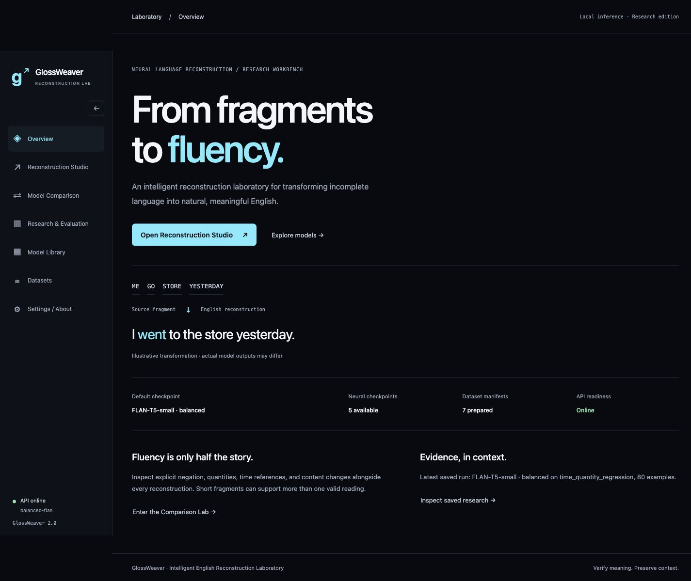
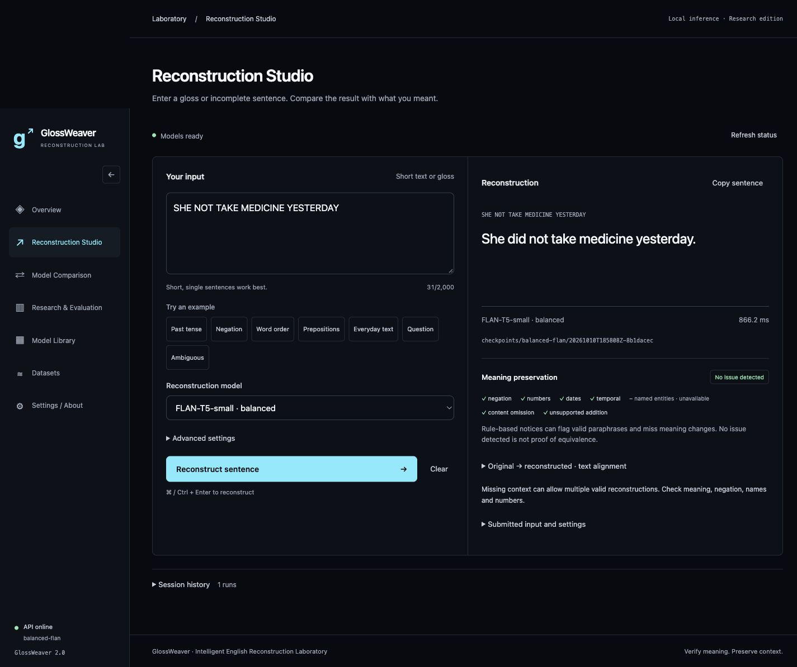
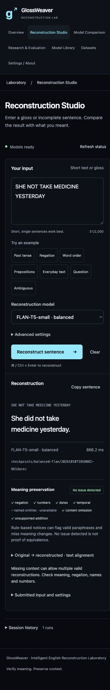

# GlossWeaver 2.0 delivery

## Actual changes in this implementation

Earlier uncommitted repository work was retained. No files were removed. Historical metric values and experiment artifacts were not modified by this implementation.

Added source modules: `src/glossweaver/semantics.py`, `src/glossweaver/data/integrity_report.py`, `src/glossweaver/evaluation/human.py`.

Modified ML/data modules: `src/glossweaver/{__init__,settings,model_registry,inference,utils}.py`, `src/glossweaver/data/{dataset,split_integrity,corruption}.py`, `src/glossweaver/modeling/grammar_t5.py`, `src/glossweaver/training/{train,trainer}.py`, `src/glossweaver/evaluation/{evaluate,metrics}.py`. Changes include joint source/target lineage isolation; configurable corruption probabilities and bounded temporal word-order changes; modality preservation during auxiliary deletion; masked uncertain grammar labels; CUDA BF16 on supported devices; best-checkpoint epoch-boundary resumption with compatibility checks; working-source provenance hashes; beam alternatives/deduplication; lexical semantic checks and surface alignment; explicit BERTScore opt-in; semantic/auxiliary metrics for future evaluations.

Modified scripts: `scripts/{prepare_research_data,run_experiments,run_smoke_test}.py`. The matched runner supports multiple seeds and optional short optimizer budgets. Data preparation refuses to overwrite an existing version and isolates both corpora jointly.

Backend: `app/api.py` now supports model metadata, structured inference diagnostics and alternatives, compare with partial errors, validate, evaluations, saved example analysis, and `/api/health`. Existing endpoints and legacy infer fields remain. Added a 32 KiB body limit; existing one-model cache, lazy loading, input-token checks, serialized inference, and configurable CORS remain.

Added UI components: `frontend/src/components/{Overview,ModelLibrary,ComparisonPanel,ResearchPanel,SemanticValidation,TransformationText}.jsx`. Modified `App.jsx`, `App.css`, `index.css`, `api.js`, `InferencePanel.jsx`, `MetricsPanel.jsx`, `frontend/index.html`, and `vite.config.js`. The app includes responsive navigation, all requested product areas, real result diagnostics, comparisons, research filters/sorting/charts/provenance, missing-data states, and retained in-memory Studio history across navigation. No production mock output is used.

Testing/configuration: added `tests/{test_semantics,test_platform,test_training_smoke}.py` and `frontend/src/workflows.test.jsx`; extended `tests/{test_trainer,test_corruption}.py`; updated frontend package/lock files, CI workflow, `pyproject.toml`, `.gitignore`, and the package version. New dependencies are only frontend test tooling. The compatible source-map-js patch eliminated the npm advisory encountered during installation.

Deployment/docs: added `Dockerfile`, `compose.yaml`, `.dockerignore`, `.env.example`, this report, `docs/IMPLEMENTATION_2_0.md`, and screenshots; updated README, PRODUCT, and DESIGN. Generated `datasets/processed/study_v2/` separately, plus `results/audits/study-v2.json`.

## Experimental status

No full neural training or new benchmark evaluation was executed in this implementation. Tiny randomly initialized local T5 baseline and grammar-aware training/resume runs execute in temporary directories during tests; their losses are not research outcomes.

Installed neural checkpoints: `balanced-flan`, `reconstruction-flan`, `study-augmentation`, `pretrained_flan_t5`, and `pretrained_t5`. `e0_copy` is a runnable non-neural baseline. Missing weights: historical `e1_t5`, `e2_flan`, `e3_grammar_flan`, `e4_glossweaver`, `legacy_e1`, `legacy_e4`, plus `study-baseline`, `study-grammar`, and `study-full`. The installed study-augmentation checkpoint predates study-v2; the new full matched matrix remains unexecuted.

Existing saved metrics for `balanced-flan` (not computed by this change):

| Scope | Examples | BLEU | chrF | ROUGE-L | METEOR |
|---|---:|---:|---:|---:|---:|
| balanced_development / development_diagnostic | 120 | 68.2392 | 80.1307 | 0.8969 | 0.8707 |
| untimed_present_diagnostic / development_diagnostic | 63 | 99.4641 | 99.7102 | 1.0000 | 0.9969 |
| time_quantity_regression / development_diagnostic | 80 | 100.0000 | 100.0000 | 1.0000 | 0.9988 |

These are inspected development diagnostics, not an untouched final benchmark. Historical E1–E4 saved scores remain available in the dashboard and CSV with unavailable weights identified.

Dataset-v2 audit: 102,778 examples; zero cross-split lineage keys; 4,536 repeated normalized fragments, kept within a split; 100,000 near-duplicate candidate comparisons, with bounded search explicitly reported. Prepared counts: ASLG 64,700 train / 8,135 validation / 8,158 test; reconstruction 17,597 train / 2,097 validation / 2,091 test. Selected augmented-study subsets contain 10,000 training and 1,000 validation examples and pass joint isolation.

## Verification actually run

- Initial Python suite: 39 passed.
- Expanded Python suite: 67 passed, including real tiny baseline/grammar training, resumption, saved checkpoint reload, candidate generation, API integration, semantic positive/negative cases, data integrity, and human sheet validation. A Starlette/httpx deprecation warning remains.
- Frontend: five Vitest/Testing Library workflow tests pass; oxlint passes; production Vite build passes.
- Offline smoke script: forward/backward, optimizer update, save/reload, and generation pass for tiny baseline and grammar-aware T5.
- Real `balanced-flan` CPU input `SHE NOT TAKE MEDICINE YESTERDAY`: `She did not take medicine yesterday.` The browser/API/model/validator/result flow also returned this output.
- Browser: real beam alternatives were displayed for the telescope example, including unsupported substitutions that semantic checks flagged. Real balanced-versus-copy comparison completed. Saved metrics and the example API loaded actual evaluation artifacts.
- Studio viewport checks at 1440, 1280, 1024, 768, 390, and 360 px show no page overflow. Mobile screenshot visually inspected. Native labels/focus and reduced-motion rules are included; this is not a full accessibility certification.
- `git diff --check` and `docker compose config --quiet` pass.
- npm audit after the compatible dependency patch reported zero vulnerabilities.
- Docker runtime/build was not verified: no Docker daemon socket is available. No public deployment was made.

## Remaining work and limits

Run the current matched matrix across seeds on study-v2, then evaluate untouched data and human ratings. Validate weak grammar label quality and auxiliary task impact. Current grammar supervision retains seven reconstruction-feature heads; new validated tense/polarity/sentence-type heads, per-objective sensitivity studies, and calibrated confidence are not completed. Near-duplicate candidates still need review. Lexical semantic checks do not cover all paraphrases or participant-role swaps. All-caps name checks are unavailable. Candidate ranking has no validated grammaticality classifier. The telescope test demonstrates that the installed reconstruction model can still hallucinate despite producing fluent English. No model accuracy improvement is claimed without new measured training/evaluation.

Browser cancellation does not terminate in-progress Torch computation. Resume is at the best checkpoint's epoch boundary, not mid-epoch; MPS RNG is not restored. GPU mixed precision was implemented but not tested on CUDA hardware. Docker daemon startup and container execution remain outstanding. See the README for exact installation, development, tests, dataset, evaluation, training, resume, and deployment commands.

## Screenshots

